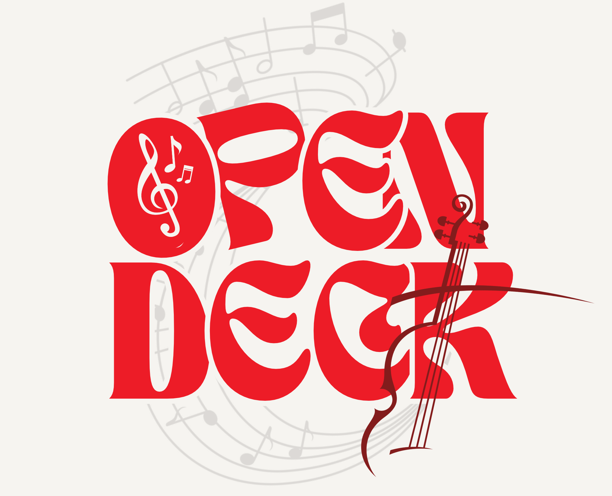
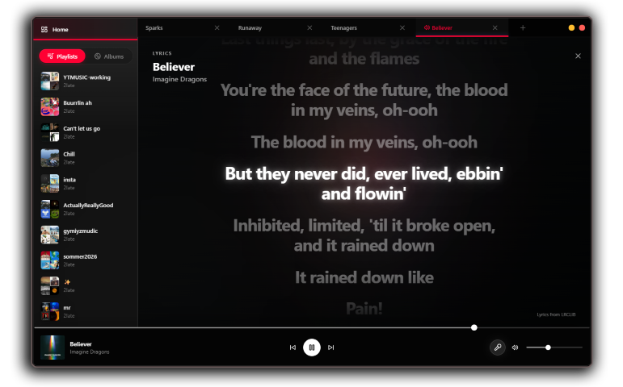

<p align="center">
  
</p>
<p align="center">
  <a href="https://github.com/saineela/opendeck/releases/latest"></a>
  <a href="https://github.com/saineela/opendeck/blob/main/package.json"></a>
  <a href="https://github.com/saineela/opendeck/blob/main/LICENSE"></a>
  <a href="https://github.com/saineela/opendeck"></a>
</p>
<br>

A **self-hosted, multi-user** music client for YouTube Music, built with React, TypeScript, Express, and SQLite — for **Windows, macOS & Linux** through any browser.

<br>

> **IMPORTANT** OpenDeck is an independent, unofficial project. It is not affiliated with, authorized by, sponsored by, or endorsed by YouTube or Google — nor by the JustAnotherMusicClient project it adapts. OpenDeck is a **web-based adaptation** of [JustAnotherMusicClient](https://github.com/2latemc/JustAnotherMusicClient), an open-source desktop YouTube Music client. It builds on the upstream project's functionality and design while adding a React and TypeScript web interface, a server-side architecture, multi-user accounts, authentication, an HTTP API, and further features. Upstream is Apache-2.0, which permits this kind of modification and redistribution with attribution — see [Credits and license](#credits-and-license).

<br>

## About ℹ️

OpenDeck brings YouTube Music to a server you control: one container, one process, **any number of accounts**. Every person who signs in gets their own isolated library — playlists, likes, settings, API keys, and YouTube Music link — while the server caches artwork and API responses **once for everyone**, so a household of listeners costs a fraction of the upstream traffic.

The UI, player, and feature set build closely on JustAnotherMusicClient; the desktop shell is replaced by a Node backend with real accounts, second-factor auth, and an HTTP API, and features like Discord presence are reworked for a shared server. This is a derivative work — attribution and licensing are in [Credits and license](#credits-and-license), and what the audio pipeline actually does is described in [Legal](#legal).

If you like this project, **starring it on GitHub** helps a lot!

## Features ✨

| Feature | Description |
|---|---|
| Multi-user accounts | Each account gets its own playlists, likes, settings, API keys, and YouTube link — fully isolated per user |
| Discord Rich Presence | Shows what you're listening to, with artwork and a link back — driven server-side, so tracks played through the HTTP API count too |
| **Secret Show** | A per-account exception list: those songs play freely but never touch Discord — your profile just shows nothing playing |
| Custom presence message | Edit your own status line ("Coding OpenDeck") above the track, plus an optional "via OpenDeck" platform tag |
| Two-factor auth | TOTP (RFC 6238) with single-use backup codes; disabling requires password + live code |
| Any OIDC sign-in | Google, Keycloak, Authentik — authorization-code + PKCE, configurable at runtime from the admin panel |
| Admin panel | Create users, change roles, revoke sessions, reset 2FA, format the artwork cache, set the **instance theme**, and run a TOTP-gated instance reset |
| Instance theme | The admin's default theme applies to the sign-in page and every account that hasn't chosen its own; personal themes still win inside the app |
| HTTP API + keys | Mint `odk_…` bearer tokens per account; full OpenAPI reference and docs served at `/docs` |
| Server-side caching | Artwork (album art, thumbnails, avatars) cached once per instance as SQLite BLOBs with ETag/304, LRU eviction, and an admin-set budget; API responses cached with a byte-capped LRU |
| Debug overlay | Admin-only cache inspector over every page: which images came from our cache, what the server holds, what the browser stores |
| Recommendations | "For you" home tab with personalized suggestions and a "Surprise me" shuffle wheel |
| Synced lyrics | Real-time synced lyrics — not even available on the official client |
| Offline playback | Queue tracks to store in your **own browser's storage** (IndexedDB) and play without a network, with quality selection and verification — the server keeps no audio files |
| Multiple tabs | Create multiple music tabs, each with its own playback queue, volume, and player state |
| Mini player | Compact player when you switch tabs, movable by drag |
| YouTube Music integration | Browse, search, like, and play through an integrated search bar, with your linked account's library merged in |
| Plugins | Official and imported plugins with app-rendered settings |
| Themes | Twelve built-in themes (including Terminal and Prism), custom CSS import, and per-theme tweaks |
| API documentation | Self-hosted reference at `/docs` with a live test client, INTEGRATION guide, and OpenAPI spec |

## Install ⏬

### Docker (recommended)

```bash
git clone https://github.com/saineela/opendeck.git
cd opendeck
docker compose up -d
```

Then open `http://localhost:4000` — the first account created becomes the admin.

### From source

Requires **Node.js LTS** and npm.

```bash
git clone https://github.com/saineela/opendeck.git
cd opendeck
npm install
npm run build
npm start          # serves the app + API on http://localhost:4000
```

For development with hot reload:

```bash
npm run dev
```

Server configuration lives in environment variables (see `.env` and `webapp/server/src/config.ts`) — `APP_SECRET`, `ADMIN_EMAILS`, `OAUTH_*`, `ALLOW_REGISTRATION`, cache budgets, and more.

<p align="center">
  
</p>

## Roadmap 📌

- Crossfade and a Web Audio equalizer (borrowed from how good modern clients do it)
- Last.fm scrobbling
- Multi-source lyrics with scored matching (LRCLIB, Genius) instead of a single provider
- SponsorBlock integration
- Playlist import/export (Spotify/YouTube Music links)
- Mobile PWA installability and offline shell
- ~~Discord Rich Presence~~
- ~~Secret Show (private listening exceptions)~~
- ~~Admin instance theme~~
- ~~Server-side artwork cache shared across users~~
- ~~HTTP API with per-account keys and full docs~~
- ~~Multi-user accounts with TOTP~~

## Platform Support 💻

OpenDeck is a web app: it runs on **any OS** where Node.js or Docker runs — Windows, macOS, Linux, NAS boxes, and small servers — and is listened to from any modern browser on desktop or phone. The Discord bridge talks to the Discord desktop client running **on the server's machine**; a remote server cannot push presence to your local Discord (the UI reports this honestly instead of silently doing nothing).

### Notes

- **Reverse proxy?** Set `TRUST_PROXY=1` so rate limits and lockouts see real client IPs.
- **Backups** are simple: stop the container, copy the data directory (`app.db` holds everything).
- **First-run setup**: visiting with zero accounts shows the admin creation screen; afterwards registration follows `ALLOW_REGISTRATION` and the admin panel switch.

## Legal

### What this software does with audio

OpenDeck relays audio from YouTube Music to its listeners and can store audio
for offline playback. Stated plainly, so nothing here is a surprise:

| Behavior | Where it happens |
|---|---|
| Relaying streams for playback | The server forwards audio from the upstream source to the authenticated listener in real time. Audio bodies are **not written to server disk**; only artwork (images) and API responses are cached server-side. |
| Offline playback | The optional downloader stores audio in the **listener's own browser storage** (IndexedDB), on their device. The server keeps no audio files. |
| Artwork & metadata caching | Images and JSON responses are cached server-side in SQLite, shared across the instance. |

Using this software does not itself grant any rights to the music it can
retrieve. The upstream project's Apache-2.0 license, and this project's
attribution to it, concern the **software's code** — they say nothing about
the copyright in recordings, videos, artwork, or metadata retrieved from
YouTube. Whether any particular use of OpenDeck is permitted depends on
YouTube's terms of service and on the law applying where you run the server
and where your listeners are. Operators are responsible for making sure
their instance's use complies with both. Nothing in this repository is legal
advice, and nothing here should be read as a claim that any particular use
is authorized.

OpenDeck does not host or claim ownership of music, videos, artwork,
metadata, or other content supplied by third parties. Rights in that content
remain with their respective owners.

YouTube and YouTube Music are trademarks of Google LLC. All other trademarks are the property of their respective owners.

- [YouTube Terms of Service](https://www.youtube.com/static?template=terms)
- [YouTube API Services Terms of Service](https://developers.google.com/youtube/terms/api-services-terms-of-service)
- [YouTube API Services Developer Policies](https://developers.google.com/youtube/terms/developer-policies)

## Credits and license

OpenDeck is a **derivative work** of [JustAnotherMusicClient](https://github.com/2latemc/JustAnotherMusicClient), created by [2latemc](https://github.com/2latemc). We thank the original author for the upstream project, whose implementation and design informed this web adaptation.

OpenDeck incorporates and modifies upstream functionality and adds a web-based interface, server-side services, multi-user authentication, an HTTP API, and other features. The known modifications are listed in [NOTICE](NOTICE).

The upstream project is licensed under the Apache License 2.0. This project retains the applicable upstream license and copyright notices and complies with the license's redistribution requirements: a copy of the License is included in [LICENSE](LICENSE), the derived-and-modified status of this codebase is documented in [NOTICE](NOTICE), and this README attributes the upstream work. Upstream does not ship a NOTICE file of its own; ours is an attribution notice for this derivative.

OpenDeck is an independent project and is not affiliated with or endorsed by the original author. See [Legal](#legal) for the separate question of content retrieved from YouTube — the software's license says nothing about that.

## For Developers 🛠️

### Prerequisites

- Node.js LTS and npm (or Docker)

### Install

```bash
npm install
```

### Run (dev, hot reload)

```bash
npm run dev        # server :4000 + Vite dev server :5173
```

### Build & run (production)

```bash
npm run build
npm start
```

### Checks

```bash
npm run typecheck  # server + client, tsc --noEmit
npm test           # vitest suites (server integration + client unit)
npm run test:e2e   # Playwright end-to-end
```

### Repository layout

```
opendeck/
├── client/          # React + Vite SPA (player, UI, datasources, plugins)
├── server/          # Express + better-sqlite3 (auth, library, cache, API, Discord bridge)
├── docs/            # API.md, INTEGRATION.md, openapi.yaml, FEATURE_INVENTORY.md
├── assets/img/      # README images and the app logo
└── Dockerfile, docker-compose.yml
```

### Contributing

Contributions are welcome. Fork the repository, create a branch for your change, run `npm run typecheck && npm test`, and open a pull request with a clear description of what you changed and why.

For larger changes, consider opening an issue first so the approach can be discussed before implementation.
